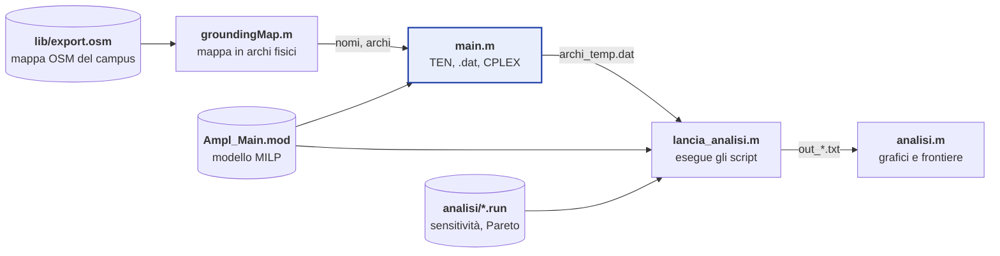

# Optimization of a Robot delivery

## Architettura implementativa

Il progetto è una catena di quattro script MATLAB eseguiti in ordine, che si passano i dati tramite variabili nel workspace e file su disco; AMPL con CPLEX è richiamato da MATLAB attraverso l'API Java.



*Catena di esecuzione. Gli script sono nell'ordine di esecuzione, con il dato che ciascuno passa al successivo; i nodi cilindrici sono i file che leggono. `main.m` è il passo centrale: costruisce la rete, scrive i dati e risolve il modello.*

## Requisiti

- **MATLAB** con Mapping Toolbox (`wgs84Ellipsoid`, `distance`, `readgeotable`, `geoplot`) e tipo `dictionary` (R2022b o successivo).
- **AMPL** con l'API per MATLAB (classi `com.ampl.AMPL`) e solver **CPLEX**.
- Variabile d'ambiente `AMPL_HOME` con la cartella di installazione di AMPL. Se manca, gli script usano un percorso predefinito locale.
- Sistema Linux o macOS per gli script di analisi, che creano la cartella di uscita con `mkdir -p`.

## Struttura del repository

```text
Optimization-of-a-Robot-delivery/
|-- groundingMap.m          # 1. mappa OSM -> archi fisici (nominale o robusto)
|-- main.m                  # 2. TEN, scrittura .dat, risoluzione, risultati
|-- Ampl_Main.mod           # modello MILP
|-- archi_temp.dat          # dati generati da main.m
|-- lancia_analisi.m        # 3. esegue gli script AMPL di analisi
|-- funzioni/
|   |-- NodiSpaceTime.m           # nodi (luogo, slot) dagli orari di apertura
|   |-- ArchiSpaceTime.m          # archi di movimento e di attesa
|   |-- Periodo.m                 # slot -> fascia oraria (1, 2, 3)
|   |-- TimeWindow.m              # estremi di un intervallo da dizionario
|   |-- estraiEstremi.m           # "N1@N10" -> ("N1", "N10")
|   |-- amplNode.m                # "N1:4" -> "N1_4" per AMPL
|   |-- robustShortestPath.m      # cammino minimo robusto (Bertsimas-Sim)
|   |-- TempoPercorrenzaTau.m     # non più richiamata
|   `-- stochasticGroundingMap.m  # versione precedente del grounding robusto
|-- analisi/
|   |-- analisi_sens_batteria.run        # sensitività alla capacità batteria
|   |-- analisi_pareto_pesi_<A>_<B>.run  # 5 frontiere di Pareto a coppie
|   |-- out_*.txt                        # risultati degli script
|   `-- analisi.m           # 4. grafici di sensitività e frontiere
`-- lib/
    |-- export.osm              # mappa usata
    |-- campus.osm              # mappa alternativa, non usata
    `-- openstreetmap/          # libreria di terze parti, non usata
```

## Flusso di esecuzione

```matlab
>> groundingMap     % crea nel workspace: nomi, archi
>> main             % crea archi_temp.dat, risolve, mostra i risultati
>> lancia_analisi   % crea analisi/out_*.txt
>> run('analisi/analisi.m')   % dalla cartella del progetto
```

| Passo | Script | Ingresso | Uscita |
|---|---|---|---|
| 1. Grounding spaziale | `groundingMap.m` | `lib/export.osm`, coordinate delle entrate | variabili `nomi` (21 nomi) e `archi` (420 archi fisici con costo, energia e tempo per fascia); mappa con entrate e incroci; tabella dell'euristica sulle stazioni |
| 2. TEN e risoluzione | `main.m` | `nomi`, `archi`, dati di pacchi, orari e finestre | `archi_temp.dat`; percorso, SOC, caricamenti e consegne a video; grafico del percorso |
| 3. Analisi | `lancia_analisi.m` | `Ampl_Main.mod`, `archi_temp.dat` | `analisi/out_sens_batteria.txt`, `analisi/out_pareto_pesi_*.txt` |
| 4. Grafici | `analisi/analisi.m` | file `out_*.txt` | figura con sensitività e frontiere dei punti non dominati |

`main.m` non richiama `groundingMap.m`: si aspetta `nomi` e `archi` già nel workspace e si ferma con un errore esplicito se mancano.

## Convenzioni sui nomi

| Oggetto | Formato | Esempio |
|---|---|---|
| Nodo fisico | nome senza `:`, `_`, `@` | `N10` |
| Arco fisico | `NOME@NOME` | `N1@N10` |
| Nodo spazio-temporale in MATLAB | `NOME:SLOT` | `N10:12` |
| Nodo spazio-temporale in AMPL | `NOME_SLOT` | `N10_12` |
| Pacco | `P` + indice | `P7` |

Il modello AMPL ricava luogo e slot dal nome del nodo dividendolo sul carattere `_`. Per questo i nomi dei luoghi non possono contenere separatori, e `main.m` lo verifica.

## Parametri di configurazione

| Parametro | File | Valore | Effetto |
|---|---|---|---|
| `ENTRATE` | `groundingMap.m` | 21 coppie lat/lon | luoghi serviti; la prima è il deposito |
| `velocita`, `consumoKm` | `groundingMap.m` | 4/3/5 km/h, 45/40/50 Wh/km | tempi ed energie per fascia |
| `costoRange`, `SEME_COSTI` | `groundingMap.m` | 20–60, 42 | costi casuali riproducibili |
| `USA_ROBUSTO`, `beta`, `Gamma` | `groundingMap.m` | `false`, 0,6, 3 | grounding robusto e suoi parametri |
| `SOLO_HIGHWAY`, `DIST_MAX_AGGANCIO` | `groundingMap.m` | `false`, 30 m | filtro delle way e soglia di avviso |
| `T_MAX` | `main.m` | 47 | ultimo slot della griglia |
| `CAP_BATTERIA`, `CAP_MAX_ROBOT`, `CONSUMO_PESO` | `main.m` | 1260, 10, 0,003 | parametri del robot |
| `TASSO_RICARICA`, `PENALE_MANCATA`, `PENALE_DOMINANTE` | `main.m` | 1260, 100 000, 1 | ricarica e penali |
| `pesiPacchi`, `pacco_destinatario`, `nodi_ricarica` | `main.m` | 19 pacchi, 8 clienti, `O`/`N11`/`N12` | istanza |
| `orario_apertura`, `timeWindow` | `main.m` | una riga per luogo | orari e finestre di consegna |
| `CPLEX_TIMELIMIT`, `CPLEX_MIPGAP` | `main.m` | 600 s, 1% | criteri di arresto del solver |
| `w_costo` … `w_penale` | `Ampl_Main.mod` | 0,20 ciascuno | pesi dell'obiettivo |

## Risoluzione e lettura dei risultati

`main.m` carica modello e dati in una sessione AMPL, imposta CPLEX con limite di tempo e gap, e legge lo stato del solver. Con `solved` la soluzione è ottima entro il gap; con `limit` è mostrata con un avviso; negli altri casi lo script si ferma. I risultati comprendono:

- il percorso ordinato nel tempo, con ogni arco classificato come movimento, attesa o attesa con ricarica;
- i cinque termini dell'obiettivo in unità originali e il numero di pacchi consegnati;
- la SOC nei nodi visitati;
- i caricamenti al deposito (uno per uscita, che rende visibile il multi-trip);
- per ogni pacco: cliente, peso, slot di consegna, scadenza e ritardo.

## Analisi

Ogni file `.run` è autonomo: ricarica modello e dati, risolve in ciclo e scrive una riga per soluzione, con stato, gap e grandezze fisiche.

| Script | Cosa varia | Punti |
|---|---|:---:|
| `analisi_sens_batteria.run` | capacità della batteria: 50, 75, 100, 700, 1260 | 5 |
| `analisi_pareto_pesi_energia_penale.run` | 0,4 di peso ripartito fra energia e penale | 5 |
| `analisi_pareto_pesi_energia_ritardo.run` | energia e ritardo | 5 |
| `analisi_pareto_pesi_penale_ritardo.run` | penale e ritardo | 5 |
| `analisi_pareto_pesi_tempo_ritardo.run` | tempo operativo e ritardo | 5 |
| `analisi_pareto_pesi_energia_tempooperativo.run` | energia e tempo operativo | 5 |

Le frontiere usano il metodo della somma pesata: i due pesi in esame si dividono 0,4 e gli altri tre restano a 0,2. Questo metodo trova solo i punti sul bordo convesso della frontiera e può restituire punti ripetuti; `analisi.m` disegna perciò solo i punti non dominati. Ogni analisi richiede 5 risoluzioni con limite di 400 o 600 secondi ciascuna.
